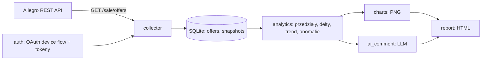

# view_tracker_ai_1

CLI do śledzenia historii liczników ofert Allegro: zbiera snapshoty wyświetleń i obserwujących,
liczy trendy, rysuje wykresy i składa samodzielny raport HTML z komentarzem AI.

Projekt zaliczeniowy na studiach AI. Działa w trybie **sandbox-first**, a bez konta Allegro
da się go uruchomić na **danych syntetycznych** (oznaczonych jako demo).

## 1. Cel

Panel sprzedawcy na Allegro pokazuje tylko **bieżące** liczniki oferty — nie widać, czy
zainteresowanie rośnie, czy spada po zmianie ceny, tytułu albo zdjęć. API Allegro nie udostępnia
historii tych liczb, więc aplikacja buduje ją sama: cyklicznie zapisuje snapshoty do SQLite,
a potem liczy z nich przyrosty, trend, pokrycie danych i anomalie (spadki licznika).

Efekt dla użytkownika: wykres PNG oraz jeden plik HTML z wykresami, tabelą liczb i krótkim
komentarzem AI, który opiera się **wyłącznie** na policzonych agregatach.

## 2. Funkcjonalność, endpointy i uprawnienia (scope)

| Funkcja | Endpoint | Scope | Status weryfikacji |
|---|---|---|---|
| Logowanie użytkownika (device flow) | `POST {auth}/device`, `POST {auth}/token` | opcjonalny `scope`; dla projektu `allegro:api:sale:offers:read` | ✅ potwierdzone w dokumentacji |
| Odświeżanie tokena | `POST {auth}/token` (`grant_type=refresh_token`) | — | ✅ potwierdzone (rotacja refresh tokena) |
| Pobranie ofert z licznikami | `GET /sale/offers` | `allegro:api:sale:offers:read` | ✅ potwierdzone (m.in. `stats.visitsCount`, `stats.watchersCount`, `limit`/`offset`) |
| Zmiana ceny oferty | `PATCH /sale/product-offers/{offerId}` | `allegro:api:sale:offers:write` | ⚠️ potwierdzone w dokumentacji, **niezaimplementowane** (etap 9 odłożony) |

Hosty: `https://api.allegro.pl` (prod) i `https://api.allegro.pl.allegrosandbox.pl` (sandbox);
autoryzacja: `https://allegro.pl/auth/oauth` i `https://allegro.pl.allegrosandbox.pl/auth/oauth`.
Wszystkie żądania wysyłają `Accept: application/vnd.allegro.public.v1+json` oraz **obowiązkowy**
`User-Agent: NazwaAplikacji/Wersja (+URL)`.

**NIEZWERYFIKOWANE** (dokumentacja tego nie rozstrzyga, kod przyjmuje założenie): czy `scope`
w device flow idzie w query stringu, czy w ciele żądania (kod wysyła w query). Pełna lista
w [`docs/api-notes.md`](docs/api-notes.md) §8.

Komendy:

| Komenda | Co robi |
|---|---|
| `auth login` / `auth status` | device flow; status tokena bez wypisywania sekretów |
| `collect [--status S] [--loop] [--interval SEC]` | snapshoty wszystkich ofert o statusie (domyślnie `ACTIVE`), tryb ciągły |
| `offers list [--status S]` | oferty z bazy z datą ostatniego snapshotu |
| `chart --offer ID --range R [--metric M] --out F.png` | dwupanelowy wykres PNG |
| `comment --offer ID --range R [--metric M] [--no-ai]` | komentarz AI do wyników |
| `report --range R [--range R] [--offer ID] [--metric M] [--no-ai] --out F.html` | samodzielny raport HTML |

Przedziały: `24h`, `7d`, `30d`, `90d`, `all`. Metryki: `visits` (wyświetlenia), `watchers` (obserwujący).

> **Uwaga o nazewnictwie:** API nie ma „polubień”. Najbliższym pojęciem jest `watchersCount`,
> więc w całej aplikacji mówimy **„obserwujący”**.

## 3. Schemat przepływu danych



Opis krok po kroku i to, czego przepływ **nie** robi: [`docs/data-flow.md`](docs/data-flow.md).

## 4. Instrukcja uruchomienia

### Wymagania

- Python **3.11+** (projekt rozwijany i testowany na 3.14.6),
- system z konsolą; ścieżki i komendy pokazane dla Windows/PowerShell,
- konto Allegro **Sandbox** — tylko jeśli chcesz dane z prawdziwego API. Bez niego działa tryb demo.

### Instalacja

```powershell
python -m venv .venv
.\.venv\Scripts\Activate.ps1
pip install -r requirements.txt -r requirements-dev.txt
pip install -e .
```

Od tej chwili `view_tracker_ai_1` jest komendą w aktywnym środowisku. Równoważnie:
`python -m view_tracker_ai_1.cli <komenda>`.

### Zmienne środowiskowe

Wzór: [`.env.example`](.env.example). Plik `.env` trzymaj **poza repo** (jest w `.gitignore`).

| Zmienna | Do czego | Wymagana | Przykład (bez prawdziwej wartości) |
|---|---|---|---|
| `ALLEGRO_CLIENT_ID` | identyfikator aplikacji z portalu | tak (API) | `twoj-client-id` |
| `ALLEGRO_CLIENT_SECRET` | sekret aplikacji | tak (API) | `twoj-client-secret` |
| `ALLEGRO_ENV` | `sandbox` albo `prod` | nie (dom. `sandbox`) | `sandbox` |
| `ALLEGRO_USER_AGENT` | obowiązkowy nagłówek UA | nie (jest domyślny) | `view_tracker_ai_1/0.0.1 (+https://github.com/...)` |
| `TOKEN_STORE_PATH` | plik z tokenami | nie | `~/.config/view_tracker_ai_1/tokens.json` |
| `DB_PATH` | baza SQLite | nie | `data/sandbox.db` |
| `LLM_PROVIDER` | `anthropic` albo `none` | nie (dom. `none`) | `anthropic` |
| `ANTHROPIC_API_KEY` | klucz do modelu | tak (AI) | `sk-ant-...` |
| `LLM_MODEL` | nazwa modelu | tak (AI) | nazwa modelu z dokumentacji dostawcy |
| `ALLOW_PROD_WRITES` | zapisy do API na produkcji | nie (dom. zablokowane) | `0` |
| `LOG_LEVEL` | poziom logowania | nie (dom. `INFO`) | `INFO` |

### Połączenie z prawdziwym API (sandbox)

1. Zarejestruj aplikację na <https://apps.developer.allegro.pl.allegrosandbox.pl/> — typ
   **„bez dostępu do przeglądarki”** (device flow), scope `allegro:api:sale:offers:read`.
2. Uzupełnij `.env` (patrz tabela wyżej) i ustaw `ALLEGRO_ENV=sandbox`.
3. Załóż konto sprzedawcy w sandboxie i wystaw kilka ofert ze statusem `ACTIVE`.
4. Zaloguj się i zbierz dane:

```powershell
view_tracker_ai_1 auth login --env sandbox
view_tracker_ai_1 auth status
view_tracker_ai_1 collect --env sandbox
view_tracker_ai_1 offers list
```

Szczegółowa checklista: [`docs/manual-sandbox-checklist.md`](docs/manual-sandbox-checklist.md).

### Tryb demo (bez konta Allegro)

```powershell
python scripts/seed_demo_data.py --db data/demo.db --seed 42
view_tracker_ai_1 --db data/demo.db chart --offer 1001 --range 30d --out reports/chart.png
view_tracker_ai_1 --db data/demo.db report --range 7d --range 30d --no-ai --out reports/report.html
```

Dane demo mają `source='synthetic'`, trafiają do **osobnej** bazy i każdy wykres oraz raport
jest oznaczony napisem „DANE SYNTETYCZNE”.

## 5. Przykłady

Wszystkie poniższe komendy były uruchamiane; pokazane wyjście pochodzi z rzeczywistego przebiegu
na danych demo.

**Dane demo** — generator jest deterministyczny (`--seed`, `--end`):

```powershell
python scripts/seed_demo_data.py --db data/demo.db --seed 42
# Zapisano 10047 snapshotów dla 5 ofert do data\demo.db (source='synthetic', seed=42, dni=90).
```

**Wykres** — input: seria 90 dni; output: PNG z dwoma panelami i markerami anomalii:

```powershell
view_tracker_ai_1 --db data/demo.db chart --offer 1004 --range 90d --out reports/chart.png
# Zapisano wykres: reports\chart.png
#   punktów: 2160, pokrycie: 100%, anomalie: 1
```

**Komentarz** — bez klucza API używa atrapy (oznaczonej „(komentarz bez AI)”):

```powershell
view_tracker_ai_1 --db data/demo.db comment --offer 1004 --range 90d --no-ai
# (komentarz bez AI) W przedziale 90d licznik wyświetlenia oferty „Prostownica z anomalią” …
```

**Raport** — input: wszystkie oferty, dwa przedziały; output: **jeden** plik HTML z osadzonymi
wykresami (bez zasobów zewnętrznych):

```powershell
view_tracker_ai_1 --db data/demo.db report --range 7d --range 30d --no-ai --out reports/report.html
# Zapisano raport: reports\report.html
#   ofert: 5, sekcji: 10, badge: DEMO, dane syntetyczne: tak
```

**Zmiana na koncie** (faza 3, `act price --apply`) — **nie jest zaimplementowana**; etap 9 został
odłożony. Dokumentacja endpointu jest w [`docs/api-notes.md`](docs/api-notes.md) §6.

Zrzuty ekranu (do wykonania przez człowieka — lista z komendami i rzeczami do zamaskowania):
[`docs/screenshots/README.md`](docs/screenshots/README.md).

## 6. Obsługa błędów i limitów

| Sytuacja | Zachowanie aplikacji |
|---|---|
| `401` | odświeżenie tokena **raz** i jedno powtórzenie żądania; drugi `401` → `AuthError` → kod 2 („zaloguj się ponownie: `auth login`”) |
| `422` | `ValidationError` z listą `errors` (kod, komunikat, ścieżka pola), **bez ponowień** |
| `429` | respektuje `Retry-After` (sekundy albo data HTTP); bez nagłówka — backoff wykładniczy z jitterem **od 60 s**, maks. 5 prób, potem `RateLimitError` |
| `5xx` | do 3 ponowień z backoffem, potem `ApiError` |
| timeout / błąd sieci | timeouty connect 10 s, read 30 s; do 3 ponowień, potem `ApiError` |
| inne `4xx` | `ApiError` z kodem i skróconym ciałem odpowiedzi (bez nagłówków) |
| brak danych w przedziale | `ChartError` / komunikat, kod 1 — „uruchom `collect` albo wybierz inny zakres” |
| za mało danych dla AI | stały komunikat „Za mało danych…” (mniej niż 6 punktów lub pokrycie < 30%), **bez wywołania modelu** |

Kody wyjścia: `0` sukces, `1` błąd użycia/konfiguracji, `2` błąd autoryzacji, `3` błąd API/limit.

Limity Allegro: 9000 zapytań/min na `Client ID`, blokada ~1 min po przekroczeniu; dodatkowo
`GET /sale/product-offers/{offerId}` 3500/min i `PATCH` 2500/min. Polling godzinny jest daleko
od tych progów — obsługa `429` jest ćwiczona na mockach, nie na żywym API.

## 7. Testy

```powershell
ruff check .
pytest -q
pytest -q --cov=src/view_tracker_ai_1 --cov-report=term-missing
```

- **280 testów, 1 pominięty** (uprawnienia POSIX — nie dotyczą Windows), pokrycie całości **97%**;
  `analytics.py`, `charts.py`, `report.py` i `ai_comment.py` po **100%**, `config.py` i `cli.py` 98%,
  `client.py` 97%, `storage.py` 94%, `auth.py` 92%.
- Testy działają **offline**: `tests/conftest.py` podstawia `socket.getaddrinfo`, `create_connection`
  i `connect`, więc próba połączenia z siecią wywala test. HTTP jest mockowane przez `responses`.
- Pokryte obszary: OAuth (odświeżanie, rotacja, uprawnienia pliku), klient HTTP (paginacja, `401`,
  `422`, `429`, `5xx`, timeout, brak tokena w logach), storage (idempotencja, `UNIQUE`, przedziały),
  analityka (delty, anomalie, DST 2026-10-25, cztery etykiety trendu), AI (bramka, prompt,
  wstrzyknięcie w nazwie oferty, cache, błąd modelu), wykresy i raport (plik, autoescape, badge).

Czas pełnego przebiegu: ~11 s.

## 8. Bezpieczeństwo

- **Sekrety wyłącznie w `.env`** (poza repo) lub w zmiennych środowiskowych. W repo jest tylko
  `.env.example` z nazwami zmiennych.
- **Dlaczego nie w repo:** wyciek trafia do historii gita i wymaga rotacji sekretu, a token daje
  dostęp do konta sprzedawcy (odczyt ofert, a przy `write` — także ich zmianę).
- Plik tokenów: katalog `700`, plik `600`, zapis atomowy (`mkstemp` + `os.replace`);
  tokeny mają `repr=False`, więc nie wyciekną przez `print(obiekt)`.
- **Filtr redakcji logów** maskuje `Authorization`, `access_token`, `refresh_token`,
  `client_secret`, klucze API, JWT i `sk-ant-…`.
- `.gitignore`: `.env*`, `tokens*.json`, `data/`, `reports/`, `*.db`, `*.pem`, `*.key`.
- Zapisy do API: domyślnie tylko sandbox; produkcja wymaga jawnego `ALLOW_PROD_WRITES=1`.
  (Etap 9 z zapisem jest odłożony, więc aplikacja dziś tylko czyta.)
- **Skan sekretów:** `gitleaks git --config .gitleaks.toml` — w historii i w drzewie roboczym
  zero trafień. Konfiguracja dopuszcza tylko zmyślony JWT w teście redakcji logów
  (`tests/test_config.py`) i katalogi lokalne (`.venv/`, `.tmp/`, `data/`, `reports/`).
  Można podpiąć w pre-commit: `gitleaks git --config .gitleaks.toml --pre-commit`.

## 9. Dziennik AI

Pełny zapis pracy agenta — decyzje, weryfikacje i **korekty** — jest w
[`docs/ai-journal.md`](docs/ai-journal.md). W skrócie:

- wpisy od uporządkowania dokumentów, przez weryfikację 6 faktów o API, po etapy 0–8;
- sekcja „Odstępstwa od SPEC” (5 punktów, m.in. obowiązkowy `User-Agent` i `limit` domyślnie 20);
- jawne zapisy tego, co poszło źle: fałszywe anomalie z szumu w generatorze demo, kolizje opisów
  na wykresach, wyciek połączenia SQLite, dwukrotne zepsucie kodowania pliku przez powłokę;
- decyzja D1 (etap 9): **odłożona** — projekt jest na razie read-only.

## 10. Ograniczenia

1. **Semantyka `visitsCount` jest niepewna.** Oficjalna dokumentacja nie potwierdza, że licznik
   obejmuje unikatowe wyświetlenia z okna 30 dni — to hipoteza z forum. Dlatego zapisujemy surowe
   poziomy, spadek oznaczamy jako anomalię (nie błąd) i **nie** traktujemy różnicy dwóch snapshotów
   jako „wyświetleń dziennie”.
2. **Sandbox prawie nie ma ruchu.** Bez wejść z drugiego konta liczniki stoją w miejscu, więc do
   demonstracji wykresów służą dane syntetyczne — zawsze oznaczone.
3. **Zmiana ceny (faza 3) nie jest zaimplementowana.** Etap 9 odłożony decyzją D1; kod czyta tylko.
4. **Komentarz AI nie był testowany na żywym modelu** — w repo nie ma klucza, a testy nie mogą
   wychodzić do sieci. Sprawdzone są wszystkie ścieżki techniczne (bramka, prompt, cache, błędy).
5. **Cztery `TODO(verify)`** czekają na pierwsze uruchomienie z prawdziwym kontem: miejsce `scope`
   w device flow, host `device` na sandboxie, obecność `Retry-After` przy `429`, znaczenie
   `count` vs `totalCount` w `GET /sale/offers`. Lista: `docs/api-notes.md` §8.
6. **Jeden test jest pomijany na Windows** (sprawdza uprawnienia POSIX pliku tokenów).
7. **Projekt jest sandbox-first**, nie produkcyjny: brak obsługi wielu użytkowników, brak UI
   webowego (decyzja D3: CLI + statyczny HTML).
