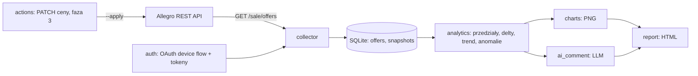

# Przepływ danych

Diagram architektury (źródło: `Project info/SPEC.md` §5).

## Przepływ w krokach

1. `auth login` — device flow (SPEC §6 FR-1), tokeny w pliku poza repo (`TOKEN_STORE_PATH`).
2. `collect` — paginacja `GET /sale/offers` (`limit` jawnie, `offset += limit`), wspólny
   `captured_at` w UTC dla całego przebiegu, zapis w jednej transakcji.
3. `analytics` — czyste funkcje na seriach: przedziały, delty, anomalie `counter_decrease`,
   agregacja dzienna w `Europe/Warsaw`, `coverage`, trend OLS.
4. `chart` / `report` — PNG i samodzielny HTML; dane `source='synthetic'` zawsze z napisem
   „DANE SYNTETYCZNE”.
5. `comment` — bramka danych (`n_points < 6` lub `coverage < 0.3` → brak wywołania LLM),
   wejście do modelu wyłącznie jako agregaty.

## Czego ten przepływ nie robi

- Nie scrapuje allegro.pl i nie używa nieudokumentowanych endpointów.
- Nie wysyła do LLM surowych danych konta ani sekretów.
- Nie miesza danych `api` i `synthetic` w jednej bazie.
