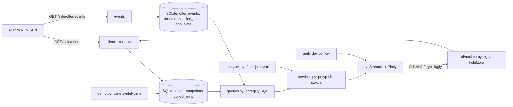

# Przepływ danych (2.0)

Diagram i ścieżki przepływu dla aplikacji webowej (SPEC-2.0 §5).

## Ścieżki

1. **Start aplikacji** — `ui/app.py` czyta stan z URL (`db`, `offer`, `range`, `metric`,
   `from`/`to`), buduje `Config` dla wybranej bazy i rysuje belkę statusu (token, świeżość,
   wersje). Brak `.env` nie jest błędem.
2. **Logowanie** — `Dane → „Rozpocznij logowanie”`: device flow (`auth.py`), kod i link
   w UI, zatwierdzenie na stronie Allegro, tokeny zapisane poza repo (`700`/`600`, atomowo).
3. **Zbieranie** — „Odśwież teraz” woła `services.refresh_once` (jeden przebieg, wpis
   w `collect_runs`). Tryb ciągły to wątek w `ui/runtime.py` z własnym połączeniem SQLite.
4. **Odczyt** — `queries.py` liczy agregaty w SQL (poziomy jednej chwili, przyrosty per oferta,
   mediana, luki, świeżość), `analytics.py` liczy serię i podsumowanie. **Nie sumujemy poziomów
   w czasie** — przyrosty per oferta, spadki pomijane w sumie.
5. **Prezentacja** — `services.py` składa dane dla stron, `ui/charts.py` rysuje Plotly
   (poziom + dzienne przyrosty + znaczniki zdarzeń/adnotacji). UI nie zna SQL-a.
6. **Zdarzenia i adnotacje** — `events.py` parsuje `GET /sale/offer-events` (kształt
   niezweryfikowany, plan B: adnotacje ręczne) i ocenia alerty progowe.
7. **Demo** — `demo.py` generuje deterministyczne dane syntetyczne do `data/demo.db`;
   generator odmawia dopisania do bazy z danymi z API.

## Czego ten przepływ nie robi

- Nie scrapuje allegro.pl i nie używa nieudokumentowanych endpointów.
- Nie miesza danych `api` i `synthetic` w jednej bazie.
- Nie wysyła nigdzie tokenów ani sekretów; nie eksportuje plików (2.0 wycofało eksport).
- Nie uruchamia pętli bez jawnego włączenia w UI.
